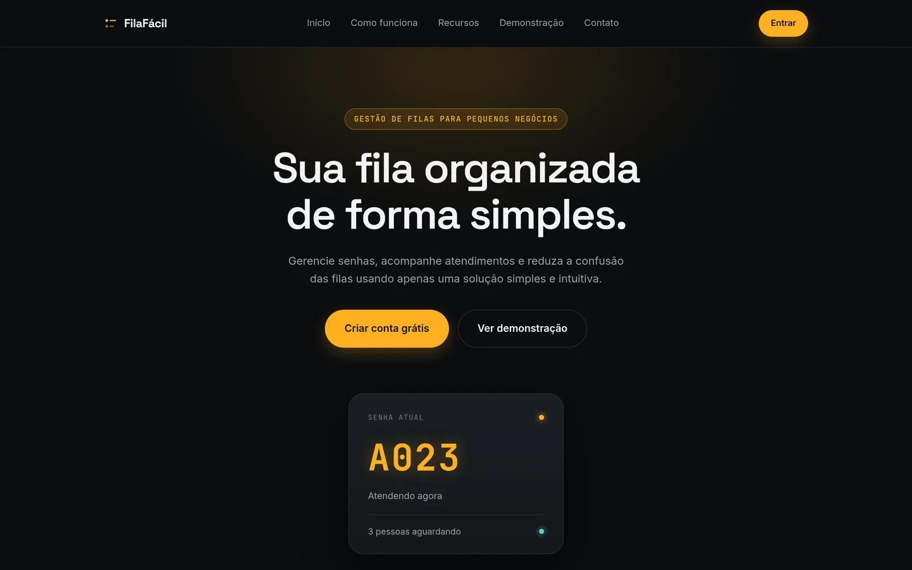
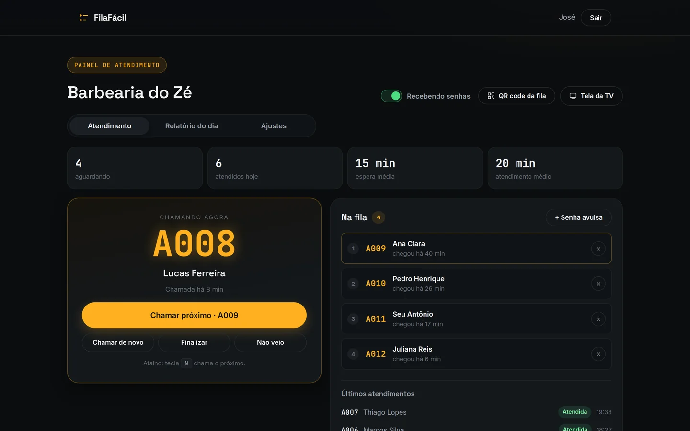
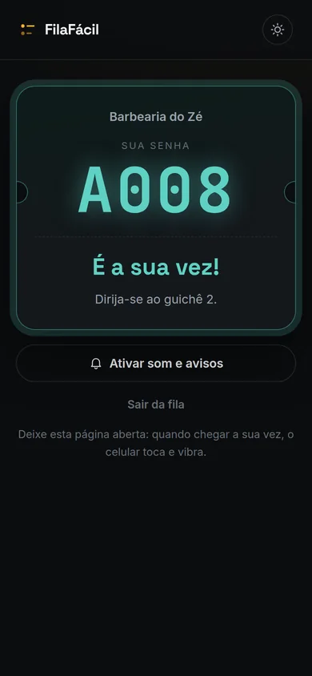
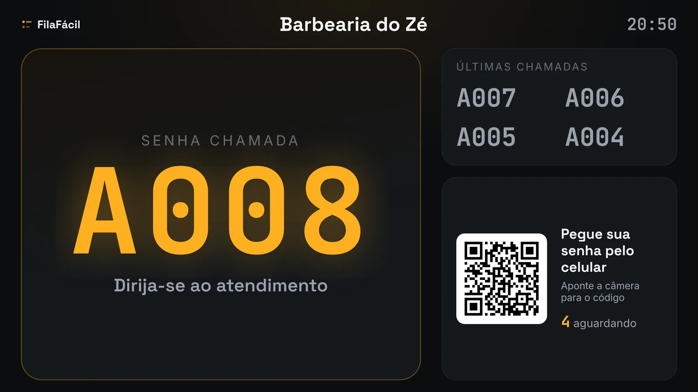

# FilaFácil



**Site:** https://fila-facil-app.onrender.com · **Entrar:** https://fila-facil-app.onrender.com/app.html

Sistema de gestão de filas para pequenos negócios. O estabelecimento cria a conta e mostra um QR code; o cliente pega a senha pelo celular e acompanha a vez; o atendente chama o próximo com um clique, e o celular do cliente toca. Pensado para barbearias, salões, oficinas, lanchonetes, pequenos comércios, recepções, clínicas e eventos.

## Como funciona

1. **Pegue a senha:** o cliente lê o QR code do estabelecimento, entra ou cria a conta e toca em "Pegar senha".
2. **Acompanhe a fila:** no celular, ele vê quantas pessoas faltam e a espera estimada.
3. **Chame o próximo:** no painel, o atendente chama a próxima senha. O celular do cliente toca e vibra, e a TV mostra o número.



## Recursos

**Para o estabelecimento**

- Painel de atendimento: chamar o próximo (ou tecla N), chamar de novo, finalizar e marcar quem não veio
- Senha avulsa para quem chega sem celular
- Abrir e fechar a fila para novas senhas
- QR code da fila e cartaz pronto para imprimir
- Tela de chamada para TV, com a senha em letras grandes, som e voz
- Relatório do dia: senhas emitidas, atendidas, não vieram, desistências, espera média e maior espera, tempo médio de atendimento, senhas por horário e planilha (CSV)
- Ajustes: nome, letra da senha e tempo médio por atendimento

**Para o cliente**

- Senha pelo celular, sem papel
- Posição na fila e espera estimada, atualizadas sozinhas
- Aviso de "É a sua vez!" com som, vibração e notificação
- Sair da fila e histórico das senhas

O site, o app e a tela da TV têm tema claro e escuro, com a escolha salva no navegador. Quem esquece a senha da conta recebe por e-mail um link para criar outra, e a [política de privacidade](https://fila-facil-app.onrender.com/privacidade.html) explica quais dados são guardados.



A espera estimada usa o tempo médio configurado até haver 3 atendimentos no dia; depois, a média real do dia. A numeração das senhas recomeça do 1 todo dia.



Os prints do sistema usam dados de exemplo.

## Demonstração

A página inicial mantém uma demonstração do painel que funciona sem conta e salva os dados só no navegador:


## Tecnologias

- **Site:** HTML, CSS e JavaScript puros, sem frameworks, no Render (site estático)
- **API:** Node.js com Express 5, Prisma e PostgreSQL (Neon), no Render
- **Login:** JWT e bcrypt

## Estrutura

```
index.html   página de apresentação e demonstração (style.css, script.js)
app.html     sistema: login, área do cliente e painel do estabelecimento (app.css, app.js)
tv.html      tela de chamada para TV (tv.js)
privacidade.html  política de privacidade
api.js       acesso à API, sessão e som de chamada
sw.js        mostra a notificação "É a sua vez!"
tema.js      tema claro e escuro
backend/     API: rotas, schema do Prisma e migrations (veja backend/README.md)
render.yaml  serviços no Render: API e site estático
*.jpg        imagens dos tipos de negócio
docs/        imagens deste README
```

## Rodar localmente

A página inicial e a demonstração abrem direto no navegador, ou servindo a pasta:

```bash
python3 -m http.server 8000
```

Para o sistema com login, suba a API e o banco seguindo o [backend/README.md](backend/README.md).

## Autor

Hariel Silva Fabrício · [Portfólio](https://hriel123.github.io/Portifolio/) · [GitHub](https://github.com/hriel123)
